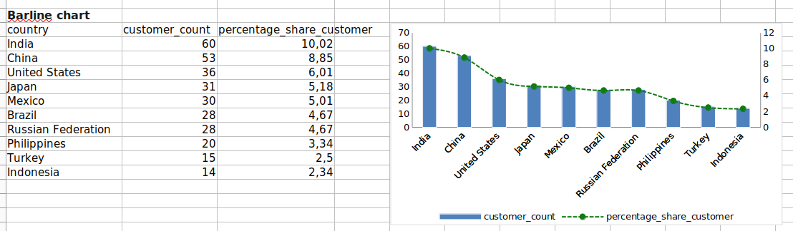

# Supported Charts

`SQL2Excel` supports several charts. Examples of how to use each chart are provided below.

## Area Chart

Refer to [Area Chart examples](https://github.com/Al-Madina/SQL2Excel/blob/main/examples/area_chart.py) and to [Excel output](assets/area_chart.xlsx) for the generated Excel workbook.

## Bar Chart

Refer to [Bar Chart examples](https://github.com/Al-Madina/SQL2Excel/blob/main/examples/bar_chart.py) and to [Excel output](assets/bar_chart.xlsx) for the generated Excel workbook.

## Barline Chart

A barline chart is not a standard chart in `Openpyxl` but is custom-built within `SQL2Excel` by combining a bar chart with a line chart, each with its own axis. This chart is ideal for presenting related data in one view, making it easier to analyze both absolute values and proportions. For instance, you can use a barline chart to show the number of customers in the top 10 countries with bars, while the percentage share of these countries out of the total customers is represented by a line. To produce a barline chart, decorate your sql query with `chart=barline`.

```sql
-- chart=barline
SELECT
    ctr.country,
    count(DISTINCT c.customer_id) AS customer_count,
    round(
        100.0 * count(DISTINCT c.customer_id) / (
            SELECT
                count(DISTINCT customer_id)
            FROM
                customer
        ),
        2
    ) AS percentage_share_customer
FROM
    country ctr
    LEFT JOIN city ON ctr.country_id = city.country_id
    LEFT JOIN address a ON city.city_id = a.city_id
    LEFT JOIN customer c ON a.address_id = c.address_id
GROUP BY
    1
ORDER BY
    2 DESC
LIMIT
    10;
```



Refer to [Barline Chart](https://github.com/Al-Madina/SQL2Excel/blob/main/examples/barline_chart.py) for the code and to [barline_chart.xlsx](assets/barline_chart.xlsx) for the generated Excel workbook.

## Bubble Chart

Refer to [Bubble Chart examples](https://github.com/Al-Madina/SQL2Excel/blob/main/examples/bubble_chart.py) and to [Excel output](assets/bubble_chart.xlsx) for the generated Excel workbook.

## Image Chart (Insert Image into Excel)

Refer to [Image Chart examples](https://github.com/Al-Madina/SQL2Excel/blob/main/examples/image2excel.py) and to [Excel output](assets/image2excel.xlsx) for the generated Excel workbook.

## Line Chart

Refer to [Line Chart examples](https://github.com/Al-Madina/SQL2Excel/blob/main/examples/line_chart.py) and to [Excel output](assets/line_chart.xlsx) for the generated Excel workbook.

## Pie Chart

Refer to [Pie Chart examples](https://github.com/Al-Madina/SQL2Excel/blob/main/examples/pie_chart.py) and to [Excel output](assets/pie_chart.xlsx) for the generated Excel workbook.

## Radar Chart

Refer to [Radar Chart examples](https://github.com/Al-Madina/SQL2Excel/blob/main/examples/radar_chart.py) and to [Excel output](assets/radar_chart.xlsx) for the generated Excel workbook.

## Scatter Chart

Refer to [Scatter Chart examples](https://github.com/Al-Madina/SQL2Excel/blob/main/examples/scatter_chart.py) and to [Excel output](assets/scatter_chart.xlsx) for the generated Excel workbook.

## Stackedbar Chart

A Stackedbar chart is not a standard chart in `Openpyxl` but is custom-built within `SQL2Excel`. It is bar chart with data series stacked on top of each other.

Refer to [Stackedbar Chart examples](https://github.com/Al-Madina/SQL2Excel/blob/main/examples/stackedbar_chart.py) for code example and to [Excel output](assets/stackedbar_chart.xlsx) for the generated Excel workbook.


## SingleAxisBarLineChart
SingleAxisBarLineChart combines bars with lines as in `BarlineChart` but differs in using a single y-axis.

Refer to [SingleAxisBarLineChart examples](https://github.com/Al-Madina/SQL2Excel/blob/main/examples/singleaxisbarline_chart.py) and to [Excel output](assets/singleaxisbarline_chart.xlsx) for the generated Excel workbook.