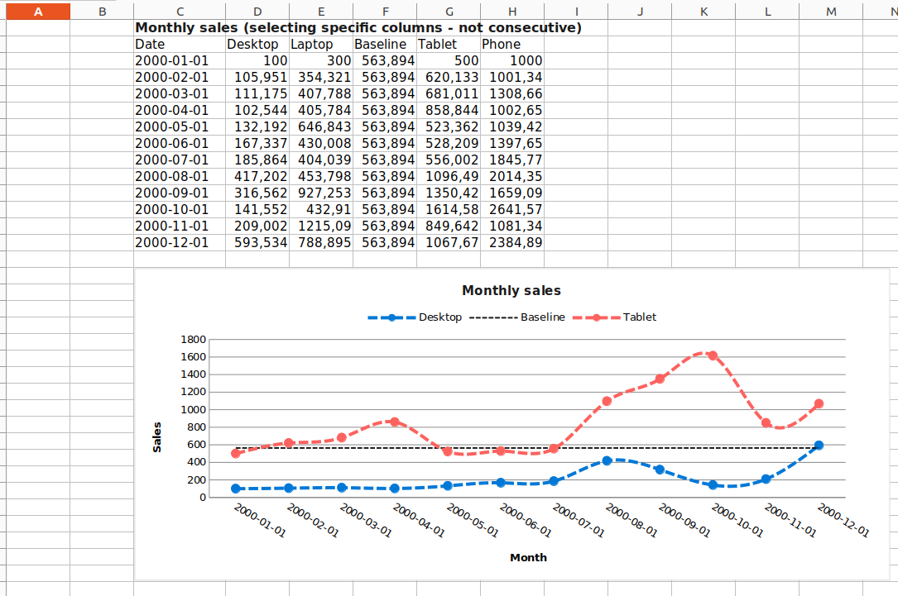

# Generate Excel from DataFrames

`SQL2Excel` supports exporting data and generating Excel visualization from Pandas DataFrames.
In fact, `SQL2Excel` works with DataFrame under the hood.

## Writing Data

To export DataFrame to Excel **without** generating charts,
you need to create an instance of the `Chart` class and call its `write_dataframe` method.
You also need to create a `Workbook` using `Openpyxl` package and write the data into a sheet. See the example below.

```python
# Use openpyxl to create Workbook (Excel file) and save it
import openpyxl as xl
from sql2excel.chart import Chart

df = ... # Create DataFrame

# Create a workbook
wb = xl.Workbook()

# Choose the active sheet
ws = wb.active

# Create a chart object
chart = Chart()

# Write dataframe
chart.write_dataframe(df, ws)

# Save the result
wb.save('path/to/file.xlsx')
```

## Writing Data and Generating Charts

You can write data and generate a chart by creating an instance of the chart class of your choice and call its `plot` method. You can either place the chart to the right of the data or below the data by setting `chart_position` to `'right'` or `'bottom'` respectively. Default is `'right'`.

```python
import openpyxl as xl
from sql2excel.chart import LineChart

df = ... # Create DataFrame

# Create a workbook
wb = xl.Workbook()

# Choose the active sheet
ws = wb.active

# Create dummy data
desktop = ... 
laptop = ...
tablet = ...
phone = ...

df = pd.DataFrame(
    {
        "Date": dates,
        "Desktop": desktop,
        "Laptop": laptop,
        "Baseline": [np.mean(laptop)] * len(laptop),
        "Tablet": tablet,
        "Phone": phone,
    }
)

chart = LineChart()
chart.plot(df, ws)

chart = LineChart()

# Let us have more customization here ...
chart.plot(
    df,
    ws,
    section_heading="Monthly sales (selecting specific columns - not consecutive)",
    title="Monthly sales",
    data_columns=[2, 4, 5], # which column to include in the chart
    line_width=3,
    line_style="sysDash",
    marker_symbol="circle",
    marker_size=8,
    # You can specify the starting row of your export
    # row_start=40, 
    # starting column
    column_start=3, 
    xlabel="Month",
    ylabel="Sales",
    width=25, 
    height=10, 
    # chart position relative to the data
    chart_position="bottom", 
    rotation=30,
    # You can disable legend
    # show_legend=False,  
    # legend position: 'r', 't', 'l', 'b'
    legend_position="t",  
)
```



Notice that we start from Column C (because `column_start=3`). By default, the x-axis ticks are rotated by 45 degree. You can set `rotation=0` if no rotation is needed.

`LineChart` detects a column that is constant (e.g. average) and plot it differently (e.g. in the above chart, you can see the column Baseline is plotted differently). You can customize this line from [config.py](https://github.com/Al-Madina/SQL2Excel/blob/main/sql2excel/config.py). To disable this feature, you can either set `use_ref_line` to `False` when invoking `plot` or override the default configuration and set `USE_REF_LINE` to `False`. See [Overriding Defaults](miscellaneous.md#overriding-defaults) for more information on overriding the default configurations. Refer to [line_chart.py](https://github.com/Al-Madina/SQL2Excel/blob/main/examples/line_chart.py) for examples of how to do this.

!!! note 
    Pivoting data is only supported if you use SQL scripts or QueryConfig as explained above. If you are working with DataFrames directly, pivot your data before calling `write_dataframe` or `plot` methods of `Chart` class.