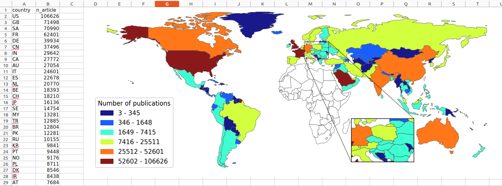

# Export External Images to Excel

The `ImageChart` class allows you to insert images from your local device by providing the absolute path to the image file.
This is ideal for adding figures generated by external tools into Excel.
The class also enables the inclusion of the data used to create the figure.

```python
from sql2excel.chart import ImageChart


# Read data
df = pd.read_csv(
    "data/Africa_collab_2013_2022.csv", delimiter=";", keep_default_na=False
)

# Insert into excel
chart = ImageChart()
# Adjust width and height while preserving aspect ratio
chart.add_image("data/Africa_collab_2013_2022.png",
                 ws, 
                 df=df, 
                 width=1425, 
                 height=552)
```



!!! note
    dataframe is optional for `ImageChart.add_image`. If not provided the image will be include but no data will be written.

!!! tip 
    When inserting images, you need to set `width` and `height` as shown above. Otherwise, your image can appear as a very small rectangle that is hardly visible.