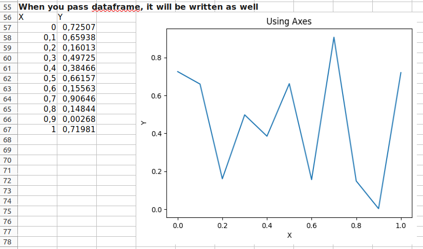

# Export Matplotlib Figures to Excel

If your report requires advanced `Matplotlib` figures, you can use the `ImageChart` class to insert figures generated by `Matplotlib` into Excel. A code snippet illustrating this is given below.

```python
from sql2excel.chart import ImageChart

# To insert the figure, use ImageChart
chart = ImageChart()

# Method 1: Using plt
fig = plt.figure()
plt.plot(df.X, df.Y)
plt.xlabel("X")
plt.ylabel("Y")
plt.title("Using plt")
plt.close(fig)

# Default insertion (DataFrame will NOT be written)
chart.add_image(fig, ws, section_heading="Inserting Matplotlib figures (using plt)")

# Method 2: Using axes
fig, ax = plt.subplots()
ax.plot(df.X, df.Y)
plt.xlabel("X")
plt.ylabel("Y")
plt.title("Using Axes")
plt.close(fig)

# Default insertion again
chart.add_image(fig, ws, section_heading="Inserting Matplotlib figures (using axes)")

# When you pass DataFrame, it will be written as well
chart.add_image(
    fig,
    ws,
    df=df,
    section_heading="When you pass DataFrame, it will be written as well",
)
```



Refer to [matplotlib2excel.py](https://github.com/Al-Madina/SQL2Excel/blob/main/examples/matplotlib2excel.py) for the code and to [matplotlib.xlsx](assets/matplotlib.xlsx) to see the output.